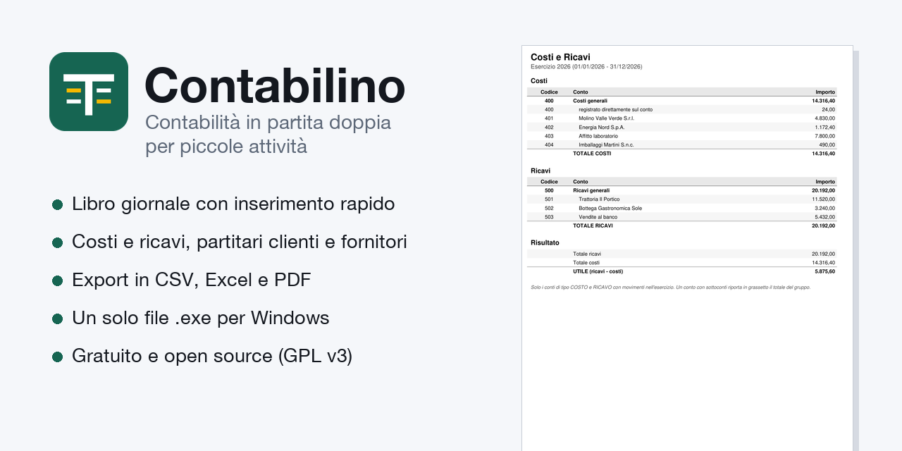

# Contabilino – contabilità in partita doppia per piccole attività

[](https://github.com/spacefilling/contabilino/releases/latest)
[](LICENSE)


**Registra costi e ricavi in partita doppia senza un gestionale.** Contabilino è un programma gratuito e open source (GPL-3.0) per Windows, pensato per piccole attività, associazioni e professionisti che tengono una contabilità essenziale: libro giornale, piano dei conti con clienti e fornitori, esercizi contabili con riporto dei saldi, costi e ricavi, partitari, export in CSV, Excel e PDF.

È un unico file `.exe` per Windows: **non serve installarlo né installare Python**. I dati stanno in un solo file `.db` accanto al programma, anche su una chiavetta USB.

**Sito e manuale:** [spacefilling.github.io/contabilino](https://spacefilling.github.io/contabilino/) · [Manuale](https://spacefilling.github.io/contabilino/manuale/)

**Download:** [Contabilino.exe (ultima versione)](https://github.com/spacefilling/contabilino/releases/latest/download/Contabilino.exe)



## Funzioni

- **Libro giornale con inserimento rapido**: una riga per registrazione (data, causale, conto Dare, conto Avere, importo), tutto da tastiera. La data si scrive compatta (`20260315` → `15/03/2026`), conti e causali si completano mentre scrivi, l'importo si digita come su un registratore di cassa.
- **Correzione, eliminazione e storno** delle registrazioni, con la scelta se rinumerare le successive. Le registrazioni di un esercizio chiuso sono protette.
- **Piano dei conti con sottoconti**: per esempio `400 Costi generali` con un sottoconto per ogni fornitore e `500 Ricavi generali` con un sottoconto per ogni cliente.
- **Esercizi contabili con periodo libero**, anche a cavallo tra due anni (es. 01/07/2026 – 30/06/2027), da aprire e chiudere.
- **Riporto dei saldi**: creando un nuovo esercizio, il programma propone di riportare i saldi di cassa, banca, crediti e debiti, con la differenza (utile compreso) su un conto di patrimonio netto.
- **Numerazione in ordine di data**: se registri un'operazione con una data precedente all'ultima, il programma chiede se rinumerare il giornale.
- **Saldi conti** con verifica della quadratura Dare/Avere.
- **Costi e ricavi**: solo i conti di costo e di ricavo, con il totale di ogni gruppo e il risultato dell'esercizio (utile o perdita).
- **Partitari**: per ogni conto (clienti, fornitori, banca, costi, ricavi…) i movimenti con data, numero, causale, contropartita, Dare, Avere e saldo progressivo.
- **Scelta dei conti da esportare**: tutti, oppure quelli spuntati in un elenco, anche per intervallo di codici (es. da 401 a 449) o cercandoli per nome.
- **Export in CSV, Excel e PDF** di tutti i report. Il PDF è pronto da stampare o da mandare al commercialista.

## Download e avvio

1. Scarica [`Contabilino.exe`](https://github.com/spacefilling/contabilino/releases/latest/download/Contabilino.exe) dall'[ultima release](https://github.com/spacefilling/contabilino/releases/latest).
2. Mettilo in una cartella (anche su una chiavetta USB) e fai doppio clic.
3. Al primo avvio Windows può mostrare l'avviso *"Windows ha protetto il PC"*: l'eseguibile non è firmato digitalmente. Clicca **Ulteriori informazioni → Esegui comunque**.
4. Scegli **crea un nuovo database**. Il file `contabilino.db` nasce nella stessa cartella e ai successivi avvii si apre da solo.

Per provarlo con dati inventati, copia [`esempi/contabilino-esempio.db`](esempi/) accanto all'eseguibile, rinominalo `contabilino.db` e avvia il programma.

## Report ed export

Menu **Export**: ogni report ha i tre formati.

| Report | Cosa contiene |
| --- | --- |
| Libro Giornale | tutte le registrazioni dell'esercizio |
| Saldi Conti | totale Dare, totale Avere e saldo di ogni conto |
| Costi e Ricavi | conti di costo e ricavo con totali di gruppo e risultato dell'esercizio |
| Partitari | i movimenti di ogni conto scelto, con saldo progressivo (proposti: i conti di costo e ricavo) |

- **CSV**: separatore punto e virgola e codifica UTF-8 con BOM, si apre direttamente in Excel italiano.
- **Excel** (`.xlsx`): titolo ed esercizio in alto, importi in formato numerico, totali, impostato per la stampa.
- **PDF**: A4 con intestazioni ripetute su ogni pagina e numero di pagina.

Esempi di export generati dal database di prova: [`esempi/`](esempi/).

## Documentazione

- [Presentazione](https://spacefilling.github.io/contabilino/)
- [Manuale completo](https://spacefilling.github.io/contabilino/manuale/)
- Le stesse informazioni in testo semplice: [`GUIDA RAPIDA.txt`](GUIDA%20RAPIDA.txt) e [`GUIDA ESTESA.txt`](GUIDA%20ESTESA.txt), allegate anche a ogni release.

## Dati e backup

| Cosa | Dove |
| --- | --- |
| Registrazioni, conti, esercizi | il file `.db` (SQLite) accanto al programma |
| Backup | basta copiare il file `.db` |
| Aggiornamento del formato | fatto in automatico all'apertura, con una copia di sicurezza del `.db` prima della conversione |

Il database è un normale file SQLite: si può aprire anche con altri strumenti (es. [DB Browser for SQLite](https://sqlitebrowser.org/)).

## Eseguire dal codice sorgente

Serve Python 3.10 o successivo (Tkinter è incluso in Python per Windows e macOS).

```bash
pip install -r requirements.txt
python main.py
```

Dipendenze: `openpyxl` (export Excel), `reportlab` (export PDF), `pyinstaller` (solo per creare l'eseguibile).

### Creare l'eseguibile

```bash
pyinstaller --onefile --windowed --name Contabilino --hidden-import openpyxl main.py
```

Su Windows c'è anche [`build.bat`](build.bat). Ogni tag `vX.Y` pubblicato su GitHub avvia la [build automatica](.github/workflows/build.yml) dell'`.exe` e lo allega alla release.

| File | Contenuto |
| --- | --- |
| `main.py` | avvio, scelta o creazione del database |
| `ui.py` | finestra principale: libro giornale, saldi, menu |
| `dialogs.py` | esercizi, piano dei conti, eliminazione e storno, scelta dei conti da esportare |
| `widgets.py` | campi data, importo e autocompletamento |
| `db.py` | database SQLite e aggiornamento automatico del formato |
| `export.py` | report e scrittura in CSV, Excel e PDF |
| `dateutils.py` | date e periodi degli esercizi |

## Note e limiti

- Ogni registrazione ha **un conto in Dare e uno in Avere** con lo stesso importo: una fattura con IVA detraibile si registra in due righe (imponibile e IVA). Non tiene i registri IVA, non gestisce ratei e risconti né il bilancio civilistico.
- **Non è un software fiscale** e non corrisponde al regime di "contabilità semplificata": non produce registri obbligatori né dichiarazioni.
- L'eseguibile è per Windows a 64 bit. Dal codice sorgente funziona anche su macOS e Linux.
- Non sostituisce il commercialista: serve a tenere in ordine i movimenti e a passargli dati chiari.

## Contribuire

Segnalazioni di errori e proposte sono benvenute nelle [issue](https://github.com/spacefilling/contabilino/issues), così come le pull request.

## Licenza

Contabilino è software libero, rilasciato con la [GNU General Public License v3.0](LICENSE) (GPL-3.0-or-later).

Puoi usarlo per qualsiasi scopo, anche per lavoro, e puoi studiarlo, modificarlo e condividerlo. Se distribuisci Contabilino o una sua versione modificata, devi farlo con la stessa licenza e insieme al codice sorgente. Non può diventare un prodotto chiuso e proprietario. Il programma è fornito così com'è, senza alcuna garanzia.

Copyright (C) 2026 spacefiller.
